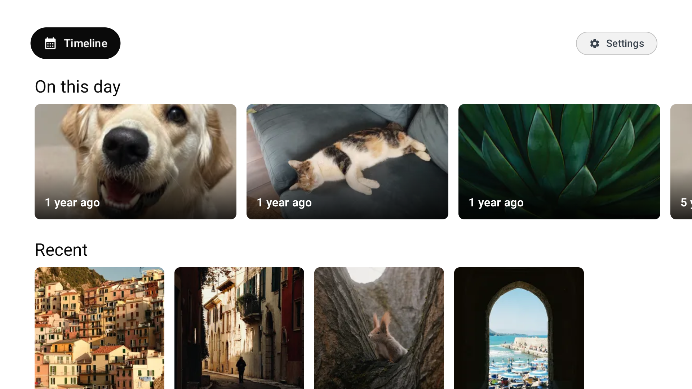
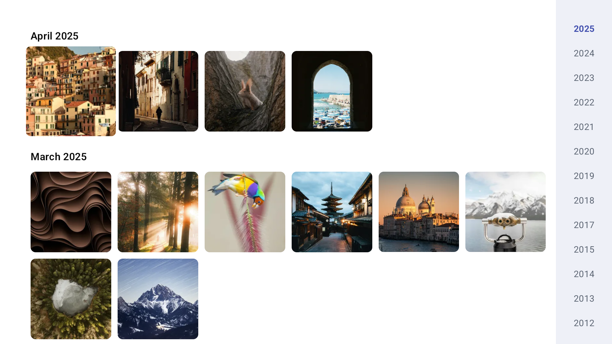

# TV client for Immich

A native **Google TV / Android TV** app for browsing your self-hosted [Immich](https://immich.app) photo & video library from the couch. Fast remote-control navigation, hardware-decoded video with HDR, and a **strictly read-only** connection: the app can look at your library, never change it.

> Unofficial, sideloaded app (not on the Play Store). Not affiliated with the Immich project.


## Why this exists

I moved my photo library from Synology Photos to Immich, and later created this app, because Synology Photos' Android client didn't play my HDR videos properly: depending on their orientation, some showed up stretched and sideways.

The root cause is an Android quirk. Phones record portrait video as landscape frames plus a "rotate 90°" flag. Of the two ways an Android app can display video, the one that keeps HDR intact can't apply that rotation, so portrait clips come out sideways and stretched. The one that can rotate always converts HDR down to washed-out SDR. A player that always uses the same method breaks either portrait videos or HDR.

This app picks per video: landscape and upright videos keep full HDR, and only rotated clips take the rotating path, so they always appear upright. It reads the rotation from the video's own metadata, because some TV decoders, including the Google TV Streamer's, under-report it.

## Features

- **Browse your whole library** — an "On this day" memories row, Recent, Albums, People, Places and Videos, plus a month-by-month timeline of everything.
- **Smart search** — search by what's *in* the photo ("beach", "birthday cake", "dog"), using your Immich server's smart search.
- **Smooth on huge libraries** — tens of thousands of photos scroll smoothly, with a year rail to jump across years instantly.
- **Photo & video viewer** — full-screen, hardware-decoded playback with **HDR**, and Motion Photos (Samsung / Apple / Google live photos).
- **Slideshow & screensaver** — start a slideshow from any photo, or use the app as your TV's screensaver.
- **Light & dark themes**, three text sizes, three Home thumbnail sizes, and **English, Spanish, Portuguese and Italian**.
- **Read-only & private** — cannot modify your server; your API key is encrypted on the device.
- **Made for the remote** — every screen works with just **D-pad, OK and Back**.

## Install on your Google TV

You'll need:

- A **Google TV or Android TV** device running Android 8.0 or newer (developed on a Google TV Streamer 4K).
- An **Immich server** the TV can reach — tested with Immich **v3.x**.
- A **computer on the same network** with Android's free [platform-tools](https://developer.android.com/tools/releases/platform-tools) installed (this provides the `adb` command).
- The app's **APK file** — download `immich-tv-<version>.apk` from the [latest release](https://github.com/ale-cubero/google-tv-client-for-immich/releases/latest).

### 1. Turn on developer mode on the TV

1. On the TV, open **Settings → System → About**.
2. Scroll to **Android TV OS build** and press **OK** on it 7 times, until it says you're a developer.
3. Go back to **Settings → System → Developer options** and turn on **Wireless debugging** (on older devices, **Network debugging** / **ADB debugging**).

### 2. Install the app from your computer

On the **Wireless debugging** screen, choose **Pair device with pairing code**. The TV shows an IP address, a port and a 6-digit code. On your computer, run:

```bash
adb pair <tv-ip>:<pairing-port>        # enter the 6-digit code when asked
adb connect <tv-ip>:<port>             # the IP and port shown under "Wireless debugging"
adb install -r immich-tv-<version>.apk
```

If the TV asks **"Allow debugging?"**, choose **Always allow**. The app then appears in your TV's apps list as **TV client for Immich**.

> To **update** later, download the newest APK from [Releases](https://github.com/ale-cubero/google-tv-client-for-immich/releases/latest) and run the same `adb install -r` — your server settings are kept. To remove it, uninstall it from the TV's app settings like any other app.

### 3. Create an API key in Immich

In the Immich web app, open your **profile picture → Account Settings → API Keys → New API Key**.

**Recommended:** give the key **read permissions only**. The app never writes, and a read-only key means the server will refuse writes too. The app needs read access to assets (including viewing thumbnails and videos), the timeline, albums, memories, people, search and server info. If a section later shows *"Couldn't load this section"*, the key is probably missing that area's read permission.

### 4. Connect

Open the app, then enter:

- **Server URL** — the address you use for Immich in a browser, e.g. `https://photos.example.com`.
- **API key** — the key from step 3.

Choose **Connect**. You can change these later under **Settings → Change server**.

> **Self-signed certificate?** When you connect, the app shows the server's certificate and its SHA-256 fingerprint. Choose **Trust and connect** only if the fingerprint matches your server. The app then accepts that exact certificate, from that server only.
>
> **No HTTPS at all?** Turn on **Allow unencrypted connection (http://)** on the setup screen. Only do this on a network you trust, because your API key and photos then travel unencrypted.

## Using the app

| Where | Button | What it does |
| --- | --- | --- |
| Everywhere | D-pad / **OK** / **Back** | Move, open, go back |
| Timeline | **←** from the left-most column | Jump to the year rail; **↑/↓** scrubs through years, **←** returns to the photos |
| Viewer | **← / →** | Previous / next photo or video (opened from the timeline, it continues across months) |
| Viewer (video) | **Hold ← / →** | Seek backward / forward |
| Viewer | **OK** | Opens an action bar: **Show details** (date, place, camera, people), **Start slideshow**, **Play / Pause** (videos), **Play motion photo**, **Go to this day** |
| Viewer | **↓** | Show the control hints again; scrolls the details panel when it's open |

The **Settings** button on Home has: change server, refresh, appearance (theme, text size, Home thumbnail size), language, slideshow options (interval, shuffle), log out, and about.

## Screenshots

**Home**

| Dark | Light |
| --- | --- |
|  |  |

**Timeline** — month-by-month grid with the year rail on the right

| Dark | Light |
| --- | --- |
|  |  |

**Viewer** — with the details panel open (OK → Show details). The viewer stays dark in both themes, since photos and videos look best on black.


<sub>Screenshots taken against the public <a href="https://demo.immich.app">Immich demo library</a> — no personal data.</sub>

## Troubleshooting

- **Can't connect** — check the URL opens in a browser on the same network, includes `https://` (or turn on *Allow unencrypted connection* for an `http://` server), and that the API key hasn't been deleted in Immich.
- **"Secure connection failed" after it worked before** — your server's certificate probably changed (for example, a renewed self-signed certificate). Open **Settings → Change server** and select **Connect** to review and trust the new one.
- **A section says "Couldn't load this section"** — press **Retry**. If it keeps failing, the API key may lack read permission for that area, or the server version may be unsupported (the app targets Immich v3.x).
- **"On this day" is missing** — that's normal on days your library has no memories.
- **Smart search finds nothing** — smart search needs machine learning enabled on your Immich server.
- **A video won't play** — the app plays whatever the server sends. If Immich's video transcoding is turned off, your device may not support that video's codec; turning transcoding on in Immich's video settings usually fixes it.
- **Screensaver** — choose **TV client for Immich** under **Settings → System → Screensaver**, where your device lets you pick a third-party screensaver.
- **HDR** — HDR output depends on your TV and its HDMI settings.

## Read-only and private by design

- **Can't modify your server.** No upload, delete, favorite or edit. A network-level guard (`ReadOnlyInterceptor`, unit-tested) blocks every request except reads (`GET`/`HEAD`) and two known read-only `POST`s (token validation, metadata search). Pair it with a read-only API key for defense in depth.
- **No blanket certificate bypass.** A self-signed certificate is trusted only after you approve its fingerprint, and only that exact certificate, from that server.
- **Your API key is protected.** It's encrypted at rest with a non-exportable Android Keystore AES-GCM key, sent only to your server's own address (never across redirects), masked on screen, redacted from logs, and excluded from device backups.

## Status

In daily use on a Google TV Streamer 4K with a ~14k-item library. All core screens are built: Home, timeline, albums, people, places, smart search, the photo/video viewer, slideshow and screensaver. Expect the occasional rough edge.

## Privacy

The app collects nothing: no analytics, ads or tracking, and it talks only to the server you set up. See the [privacy policy](docs/PRIVACY.md).

## License

[GNU AGPL-3.0](LICENSE) © 2026 Alejandro Cubero — the same license as the [Immich](https://immich.app) project this client is built for.

This is an **unofficial** third-party client and is **not affiliated with, endorsed by, or sponsored by the Immich project**. "Immich" and the Immich logo are property of their respective owners; this project uses its own icon and only references the Immich name descriptively.

## Acknowledgements

Built on top of the excellent [Immich](https://immich.app) project.
