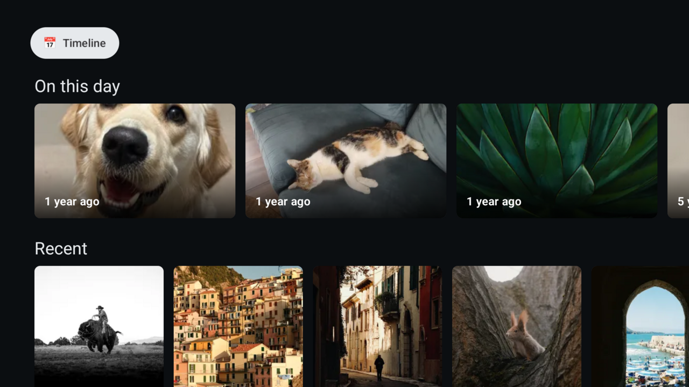
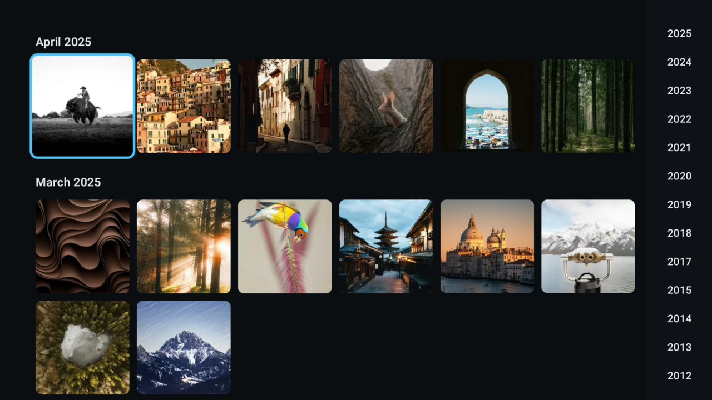
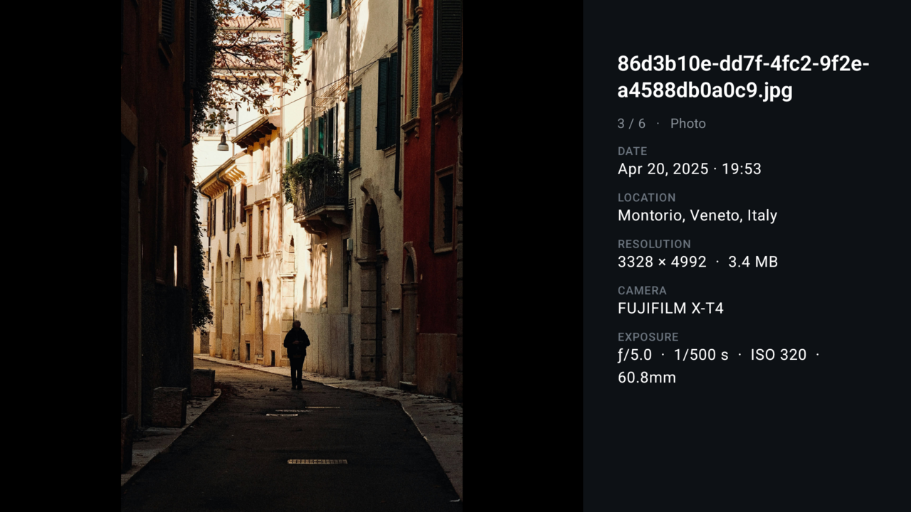

# Immich TV

A native **Android TV / Google TV** client for a self-hosted [Immich](https://immich.app) photo & video server. Built for the living-room: fast D‑pad navigation, hardware‑decoded video, and a **strictly read‑only** connection to your library.

> Personal project, sideloaded to a Google TV Streamer — no Play Store. Not affiliated with the Immich project.

## Screenshots

**Home** — memories, recent, albums, people, and videos rails


**Timeline** — bucketed grid with a year scrubber on the right edge


**Viewer** — full‑screen photo with the metadata panel (OK on a photo)


<sub>Screenshots taken against the public <a href="https://demo.immich.app">Immich demo library</a> — no personal data.</sub>

## Features

- **Home** — an "On this day" memories row plus Recent, Albums, People, and Videos rails.
- **Timeline** — the whole library in one smooth grid, driven by Immich's month "buckets": all month boundaries are known up front, each month's assets load lazily as you scroll, with prefetch and an LRU that evicts far‑off months. A year scrubber on the right edge jumps across a multi‑year library instantly.
- **Albums & People** — browse an album or a person's photos in the same grid.
- **Viewer** — full‑screen pager for photos and videos:
  - Photos load a cached thumbnail instantly, then the high‑res preview.
  - Videos play via Media3/ExoPlayer (server decides direct‑play vs transcode).
  - **OK** on a photo opens a metadata panel (date, location, resolution, camera, lens, exposure, people); **←/→** page; **hold ←/→** seeks video.
  - **Motion Photos** (Samsung/Apple/Google live photos) show a **◉ LIVE** badge and play their motion clip on demand with **OK**.
- **Slideshow** — interval slideshow from the viewer (Play/Pause key).
- **Screensaver** — a `DreamService` that runs a photo slideshow as the system screensaver.

Every screen is fully operable with **D‑pad + OK + Back**.

## Read‑only by design

The app **cannot modify anything** on your server — no upload, delete, favorite, or edit. This is enforced at the network layer by a `ReadOnlyInterceptor` (unit‑tested) that blocks every non‑`GET`/`HEAD` request except two known read‑only `POST`s (token validation, metadata search). Recommended: pair it with a **read‑only Immich API key** for defense in depth.

## Security

The API key is a bearer credential and is handled accordingly:

- **Encrypted at rest** with a non‑exportable Android Keystore AES‑GCM key.
- **Host‑scoped** — the key is attached (via a network interceptor) only to the configured server's origin, never leaked across redirects.
- **Backup disabled**, key field **masked**, auth header **redacted** from logs.

## Tech stack

Kotlin · Jetpack Compose (`androidx.tv:tv-material`) · Media3 ExoPlayer · Coil 3 · Retrofit + kotlinx.serialization · OkHttp (shared by Retrofit, Coil, and ExoPlayer) · Hilt · DataStore · MVVM + repository + Flows. `minSdk 26`, `targetSdk 35`.

The API layer is **hand‑written** for the ~dozen endpoints in use (not generated from the OpenAPI spec). Tested against **Immich v3.x**, whose timeline API returns a compact columnar (structure‑of‑arrays) payload.

## Build & install

Requires the Android SDK and a JDK 17.

```bash
# Debug
./gradlew :app:assembleDebug

# Signed release (needs keystore.properties + a keystore — see below)
./gradlew :app:assembleRelease
```

Sideload to a Google TV device over the network:

```bash
adb connect <device-ip>:5555
adb install -r app/build/outputs/apk/release/app-release.apk
```

Launch **Immich TV** and enter your **server URL** and **API key** on the setup screen.

### Release signing

Create a keystore and a non‑committed `keystore.properties` at the repo root:

```properties
storeFile=/absolute/path/to/immich-tv-release.jks
storePassword=…
keyAlias=…
keyPassword=…
```

`keystore.properties`, `local.properties`, and `*.jks` are git‑ignored — never commit them.

## Status

Feature‑complete for personal use and iterated against a real ~14k‑asset library. Screensaver triggering can only be verified on a real device (Settings → System → Screensaver → *Immich TV*).

## License

[MIT](LICENSE) © Alejandro Cubero.

This is an **unofficial** third‑party client and is **not affiliated with, endorsed by, or sponsored by the Immich project**. "Immich" and the Immich logo are property of their respective owners; this project uses its own icon and only references the Immich name descriptively. The MIT license covers this client's own source only — the Immich server is a separate project under its own (AGPL‑3.0) license.

## Acknowledgements

Built on top of the excellent [Immich](https://immich.app) project.
